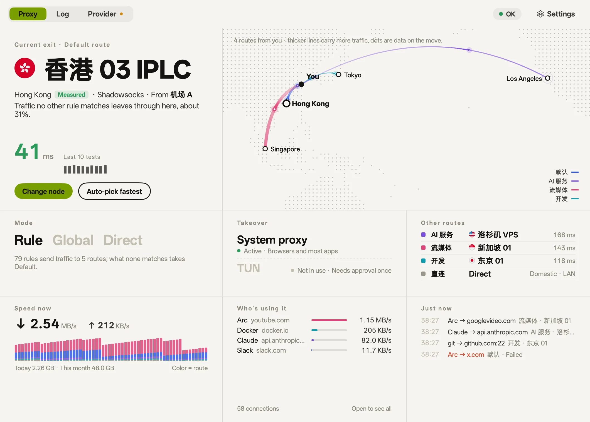
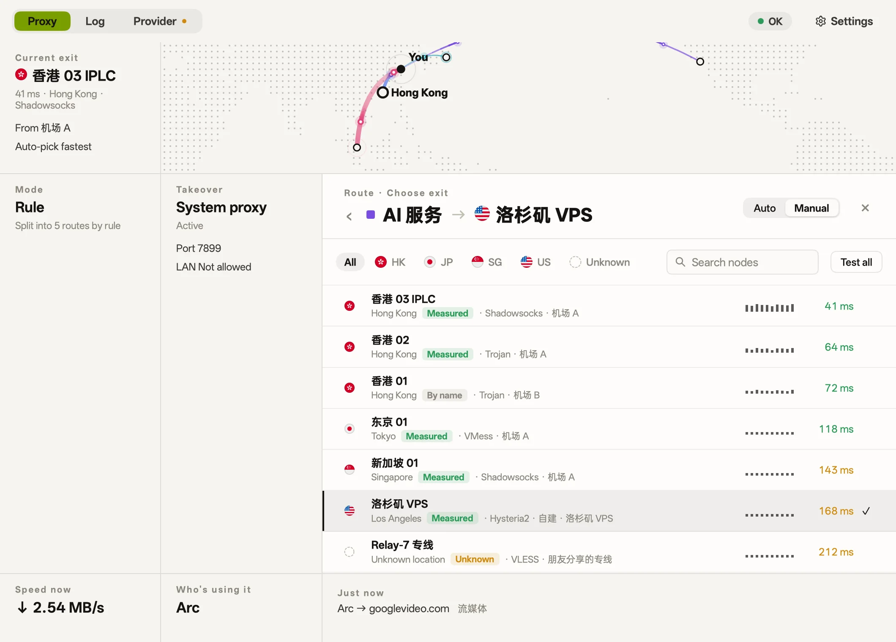
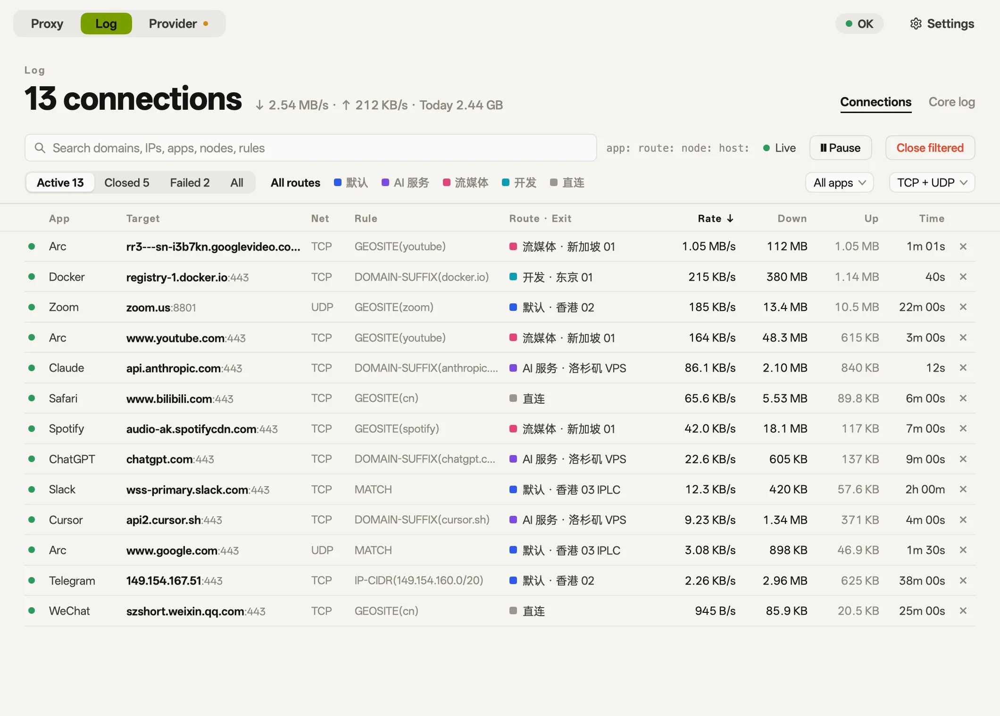
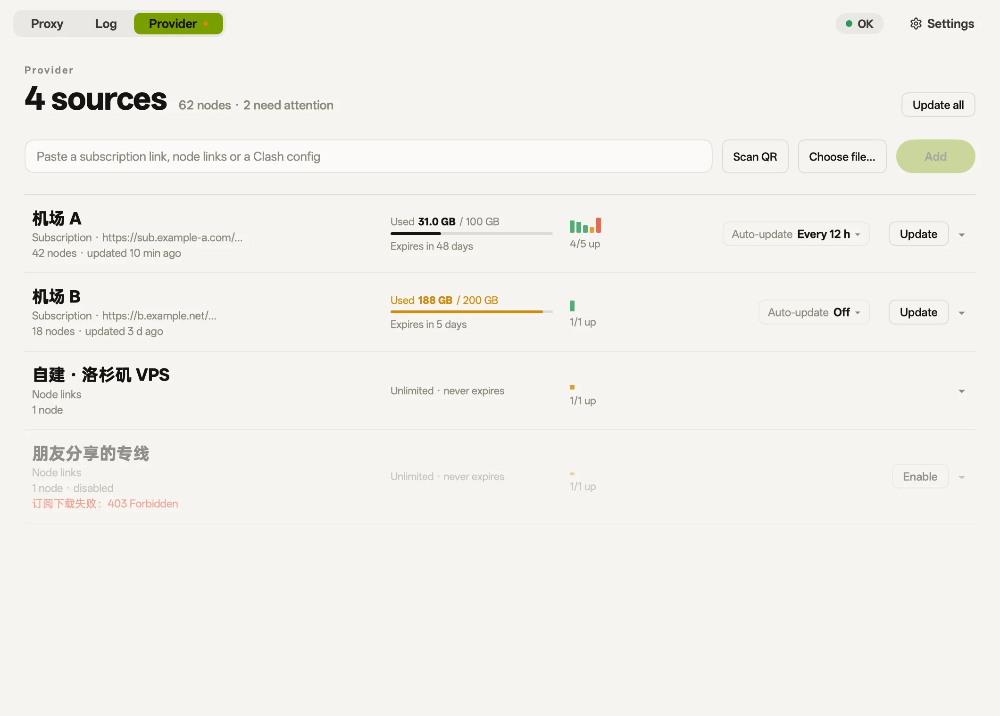
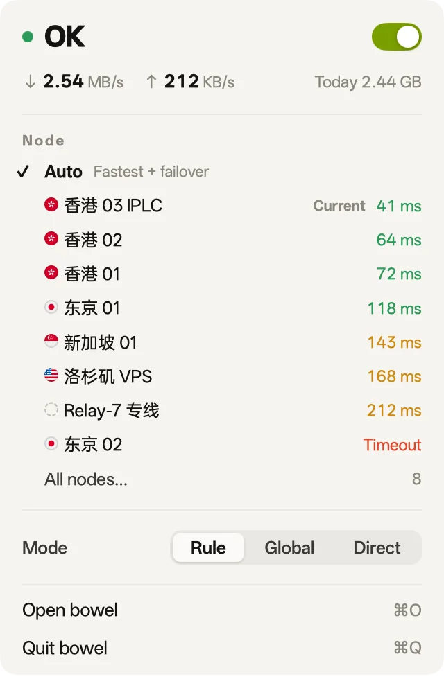
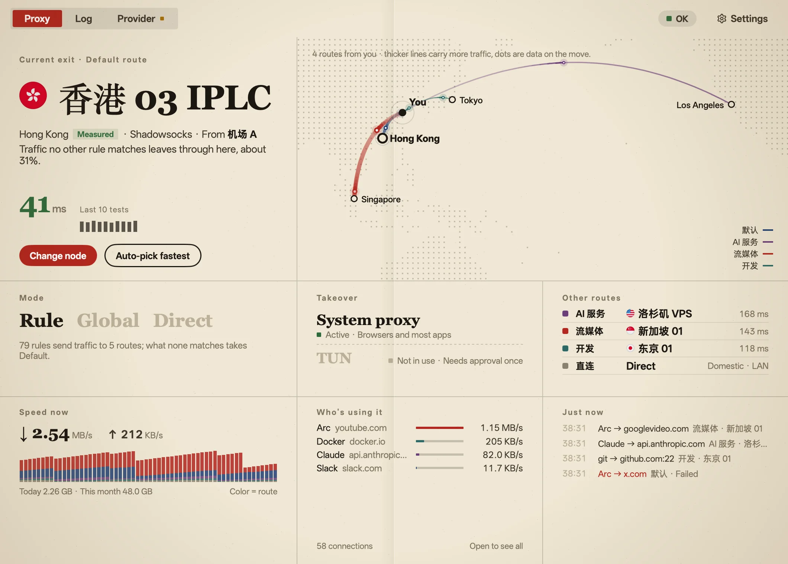
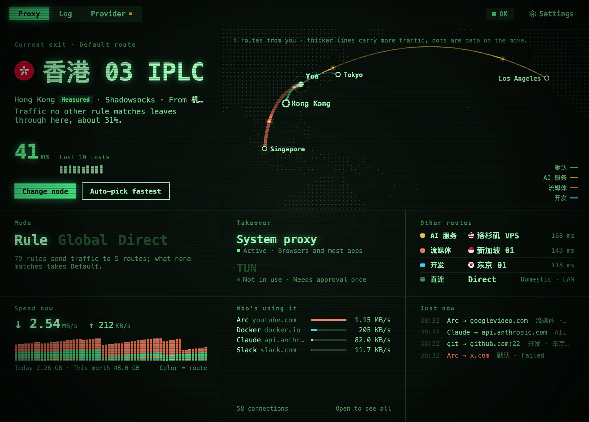
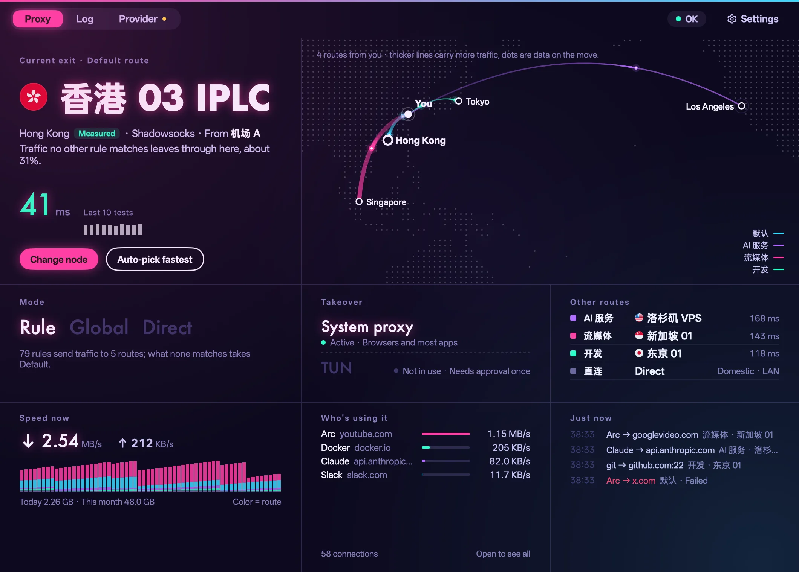
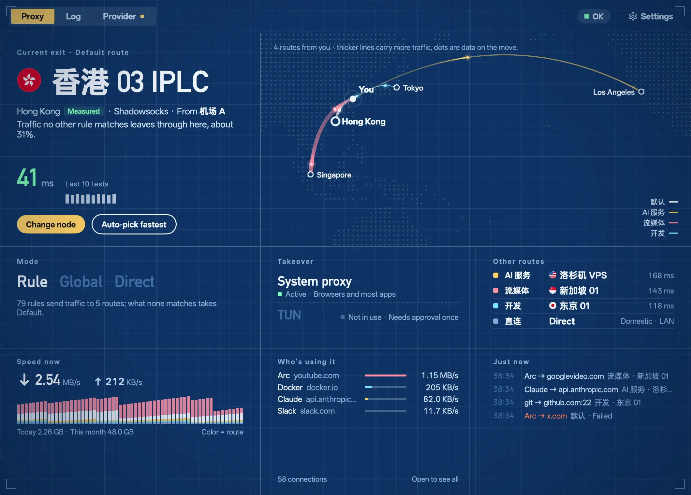
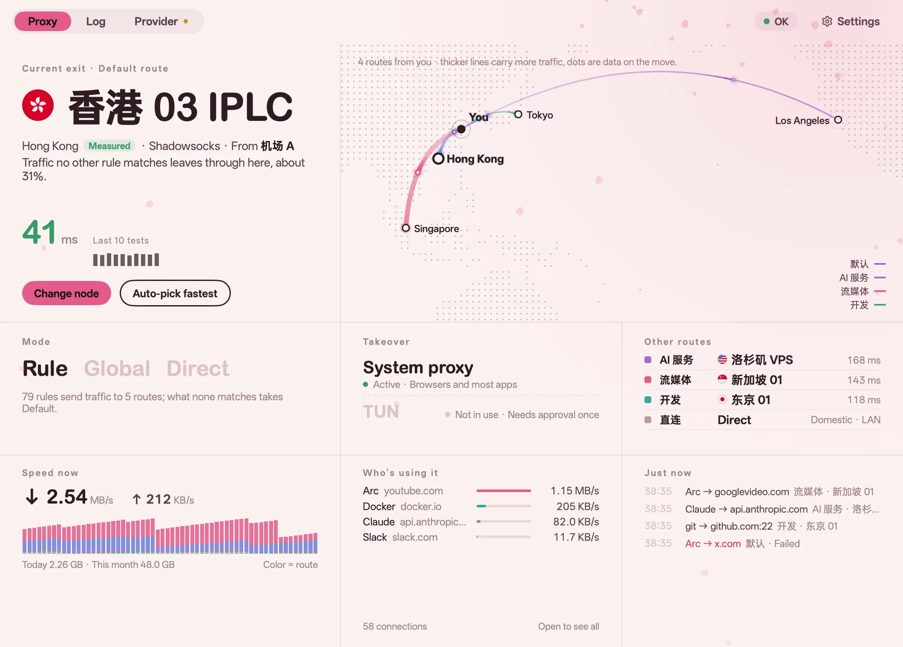

<p align="center">
  
</p>

<h1 align="center">bowel</h1>

<p align="center">
  <b>See where your traffic goes.</b><br>
  A quiet proxy client for macOS: what should be proxied takes the best exit, the rest goes direct.<br>
  When something breaks, it tells you first, then tells you how to fix it.
</p>

<p align="center">
  <a href="https://github.com/21stware/bowel/releases/latest"><b>Download for macOS</b></a> ·
  <a href="site/index.html">Website</a> ·
  <a href="README.md">简体中文</a>
</p>

<p align="center">
  <picture>
    <source media="(prefers-color-scheme: dark)" srcset="site/shots/home-en-dark.webp">
    
  </picture>
</p>

Built on the [mihomo](https://github.com/MetaCubeX/mihomo) core. The interface is written in Go and drawn on the GPU, with no webview.

## Why bowel

Most Clash-style clients hand you a row of switches and a pile of "proxy groups". bowel asks a different question: **where is my traffic going right now, and is it working?**

- **Status before controls.** The biggest words in the window are the exit you're using. Beside them, a map: one arc from you per route, thicker where more traffic flows.
- **Quiet when fine, loud when not.** There is one light in the whole app: OK, Degraded, Error or Off. When nothing's wrong, it stays out of the way.
- **Status is measured, not assumed.** Every 2 seconds bowel checks that the system proxy still points at it. If another VPN took it over, the light turns red and offers to take it back.

## Features

### Routes by purpose
Default, AI services, streaming, development and direct, out of the box. Each route picks its own exit, or leaves it to Auto: fastest, with failover. No "policy groups", no "selectors".



### Exit locations are measured
A node called "Hong Kong 03" isn't necessarily in Hong Kong. bowel requests Cloudflare's `/cdn-cgi/trace` through the node to find where it really exits, and labels each place **measured**, **by name** or **unknown**.

### Every connection, visible
Which app, to where, which rule matched, which route it took, how fast and for how long. Failed connections are red. **Send via…** on any of them hands that site (`api.openai.com → openai.com`) to another route; the open connections it affects are closed, so the change shows at once.



### Providers only supply nodes
A subscription URL, pasted node links (`vmess://`, `trojan://`, `hysteria2://`, …), a YAML file, or a QR code read by the camera or from the screen. Each source shows its usage, expiry and working nodes on one line.



### Menu bar
The takeover switch, the default exit's nodes, and Rule / Global / Direct. The icon is lit or dark; no speed ticking in the menu bar.



### Your own rules
A domain and its subdomains, one host, a keyword or an IP range, sent to any route, ahead of the built-in rules. bowel says what a rule will do before you add it, and tests where an address would go.

### Gateway mode
One switch makes this Mac the gateway for your LAN: point a TV, a console or a phone's gateway and DNS at it, and it follows bowel's rules. Forwarding, DNS and TUN are measured to be really working.

### TUN
Takes over apps that ignore the system proxy. Asks for an administrator's approval once.

### Hand it to an agent (MCP)
bowel serves an MCP server. Claude Code and other agents can read the status, routes, connections and logs to work out why a site won't load. When an agent wants to change something, bowel asks you first by default.

```bash
claude mcp add --scope user bowel -- /Applications/bowel.app/Contents/MacOS/bowel mcp
```

### Six skins
Paper, Broadsheet, Phosphor, Neon, Blueprint and Sakura. A skin changes the whole interface: palette, type, corners, glow and texture.

<table>
  <tr>
    <td><br><sub>Broadsheet</sub></td>
    <td><br><sub>Phosphor</sub></td>
    <td><br><sub>Neon</sub></td>
  </tr>
  <tr>
    <td><br><sub>Blueprint</sub></td>
    <td><br><sub>Sakura</sub></td>
    <td><br><sub>Paper (default)</sub></td>
  </tr>
</table>

Also: searchable settings (⌘F); Simplified Chinese, Traditional Chinese, English and Japanese; light and dark.

## Install

1. Download `bowel-<version>-arm64.dmg` from [Releases](https://github.com/21stware/bowel/releases/latest) and drag bowel into Applications.
2. Add a provider (a subscription URL, node links or a QR code) and turn on takeover.

Needs macOS 12 or later. Released builds are for Apple silicon, signed with a Developer ID and notarized by Apple.

## Develop

Needs Go 1.27.3+ (`GOTOOLCHAIN=auto` fetches it). No Node or Bun.

```bash
./scripts/fetch-core.sh     # mihomo + GeoSite/GeoIP data into resources/
go tool mygo dev            # the app, rebuilt on every change
go tool mygo build          # bowel.app and a .dmg, signed but not notarized
./scripts/release.sh        # build, notarize and staple: use this for releases
CGO_ENABLED=0 go test ./... # includes tests that start the real core
./scripts/site-shots.sh     # re-render the README's and the website's screenshots (needs cwebp)
```

- How it works and where the code is: [docs/architecture.md](docs/architecture.md)
- The product's information architecture: [docs/product-ia.md](docs/product-ia.md)
- The website is static, in `site/`; open `site/index.html` to preview it

bowel was called Moho. The Go module is still `github.com/oboo/moho` and the bundle identifier `dev.moho.app`, which keeps macOS's camera and screen-recording permissions. On first launch the data in `~/Library/Application Support/Moho` moves to `…/bowel`.

## Credits

- [mihomo](https://github.com/MetaCubeX/mihomo): the proxy core, GPL-3.0. bowel runs it as a separate program and does not link it.
- [MyGo](https://github.com/egoist/mygo): the native Go UI toolkit.
- [OPPO Sans](resources/fonts/): the interface's typeface.
