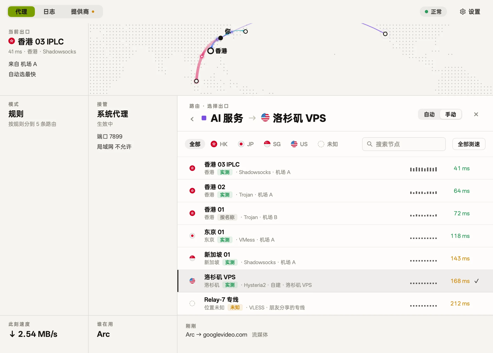
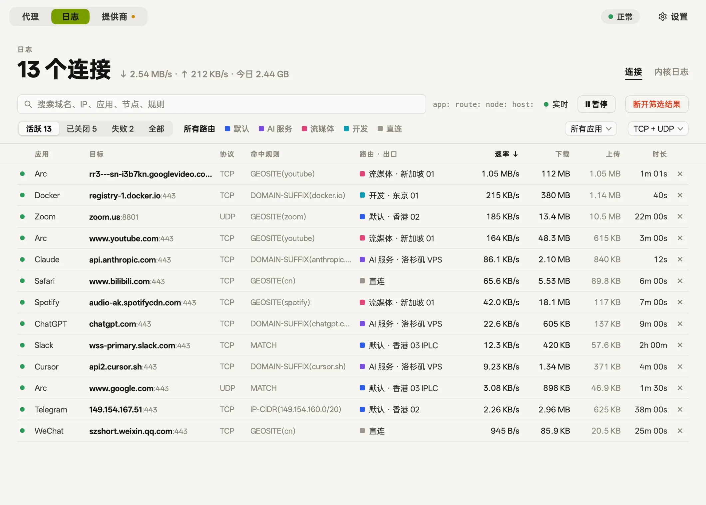
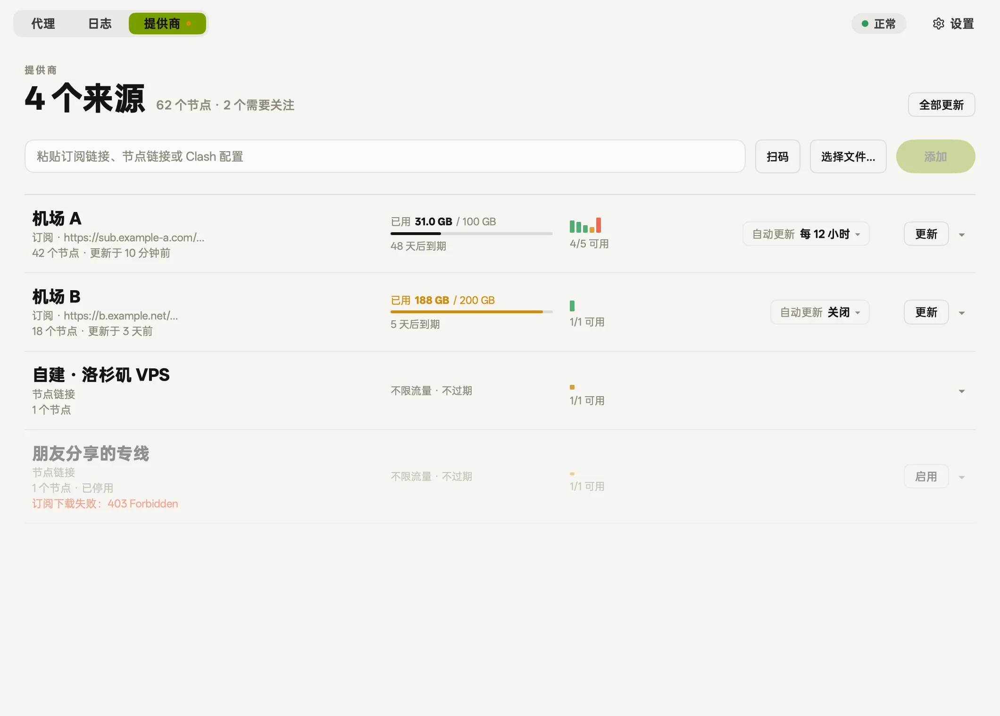
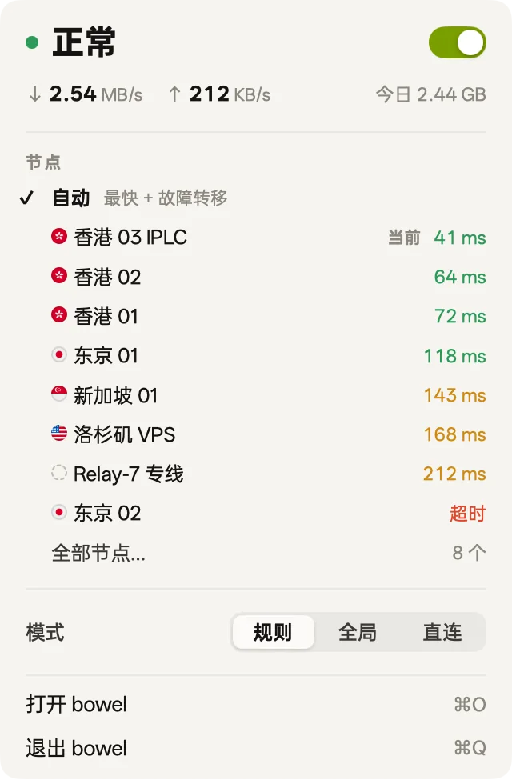
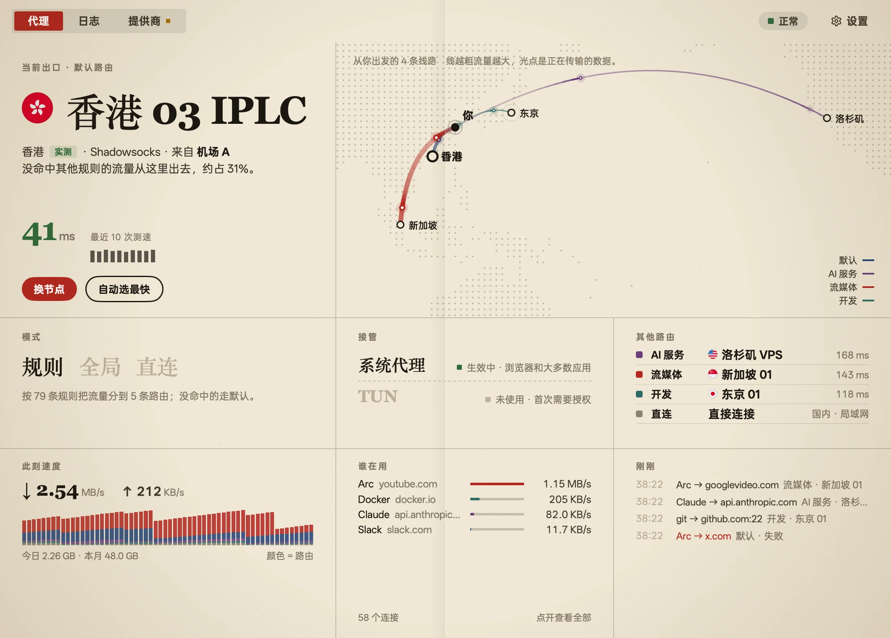
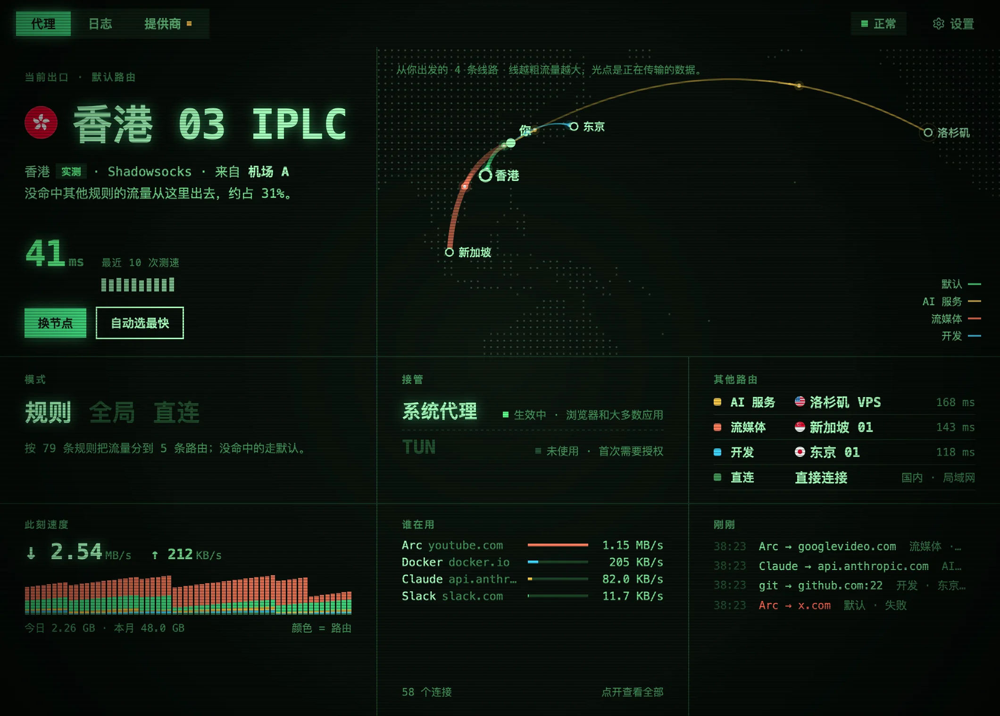
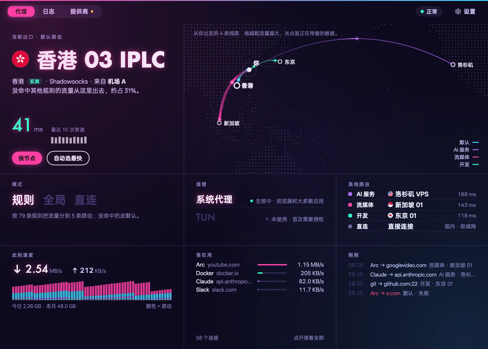
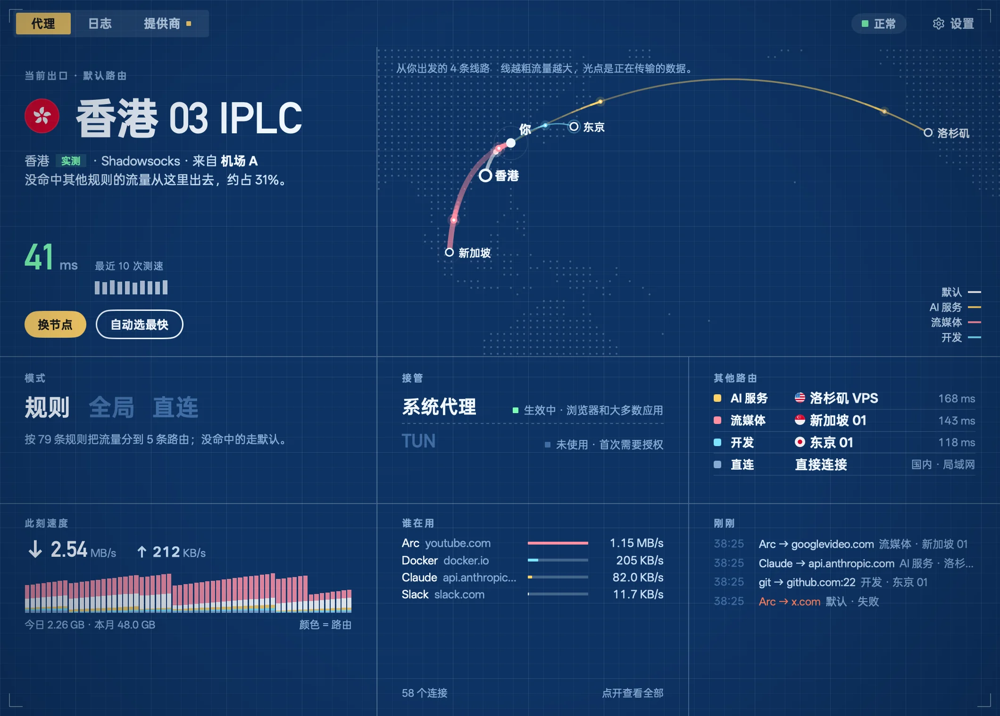
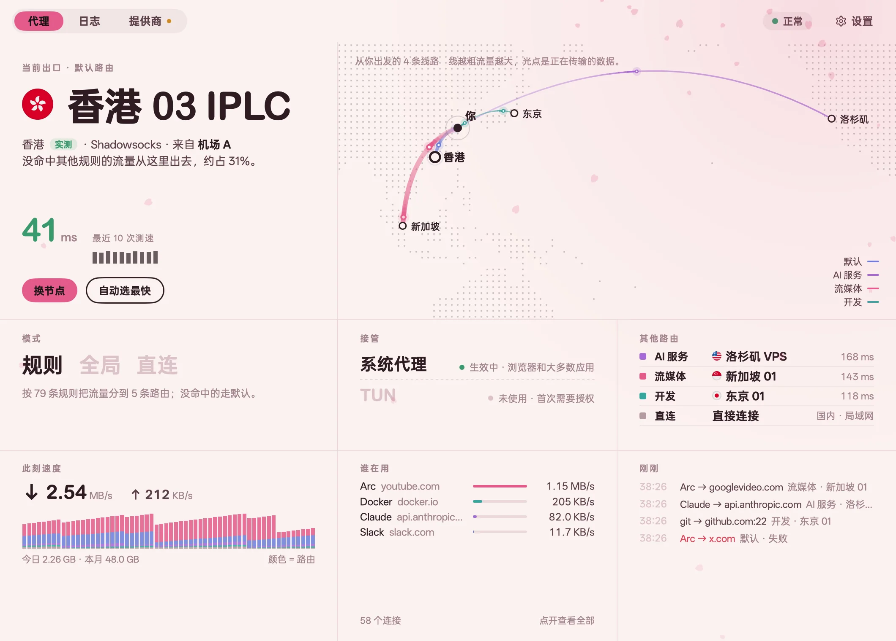
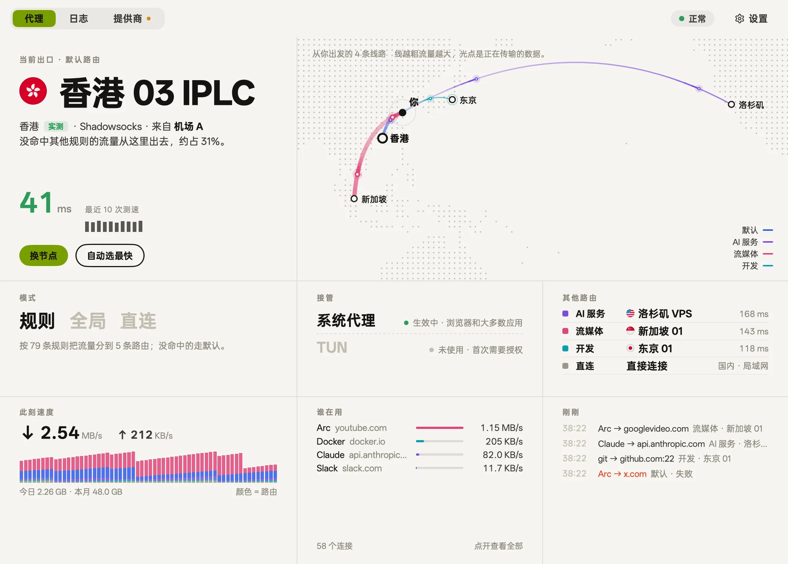

<p align="center">
  
</p>

<h1 align="center">bowel</h1>

<p align="center">
  <b>流量走哪儿，一眼看清。</b><br>
  一个安静的 macOS 代理客户端：该走代理的走最好的出口，其余直连；<br>
  出了问题，它先告诉你，再告诉你怎么修。
</p>

<p align="center">
  <a href="https://github.com/21stware/bowel/releases/latest"><b>下载 macOS 版</b></a> ·
  <a href="site/index.html">官网</a> ·
  <a href="README.en.md">English</a>
</p>

<p align="center">
  <picture>
    <source media="(prefers-color-scheme: dark)" srcset="site/shots/home-zh-dark.webp">
    
  </picture>
</p>

基于 [mihomo](https://github.com/MetaCubeX/mihomo) 内核。界面用 Go 写成、GPU 直接绘制，没有 WebView。

## 为什么是 bowel

多数 Clash 系客户端给你一排开关和一堆「代理组」。bowel 换了个问法：**现在流量走的是哪儿？正常吗？**

- **状态先于控制。** 打开主窗口，最大的字是当前出口，旁边是一张地图：从「你」出发，每条路由一条弧线，越粗流量越大。
- **正常时安静，异常时显眼。** 全产品只有一个状态灯：正常 / 降级 / 异常 / 未接管。没问题时它不打扰你。
- **状态是测出来的，不是你点出来的。** bowel 每 2 秒确认系统代理还指向自己；被别的 VPN 改掉了，它会变红并给你一个「重新接管」。

## 功能

### 按用途分路由
默认、AI 服务、流媒体、开发、直连，开箱即用。每条路由各自选出口，或者交给「自动」：最快 + 故障转移。不出现「策略组」「Selector」这种词。



### 出口位置是实测的
节点叫「香港 03」不代表它真在香港。bowel 通过节点请求 Cloudflare 的 `/cdn-cgi/trace`，量出真实出口所在地，并标明 **实测 / 按名称 / 未知**。

### 每条连接都看得到
哪个应用、连到哪、命中哪条规则、走了哪条路由、多快、多久。失败的连接标红。在任何一条上点「让它走…」，就能把这个网站（`api.openai.com → openai.com`）交给另一条路由，受影响的已有连接会被断开，重连时就走新路由，马上见效。



### Provider 只负责提供节点
订阅链接、粘贴的节点链接（`vmess://`、`trojan://`、`hysteria2://`…）、YAML 文件，或者用摄像头、屏幕扫二维码。每个来源的已用流量、到期时间、可用节点数都在一行里。



### 菜单栏
一个接管开关、默认出口的节点列表、规则 / 全局 / 直连。图标只分亮暗，不在菜单栏里跳网速。



### 你自己的规则
域名及其子域名、单个主机名、关键词、IP 段，发给任意一条路由，排在内置规则之前。添加前先告诉你它会做什么；还可以输入一个地址测试它会走哪儿。

### 网关模式
一个开关，让这台 Mac 成为局域网的网关：电视、游戏机、手机把网关和 DNS 指向它，就按 bowel 的规则上网。转发、DNS、TUN 是否真的在工作，都会实测。

### TUN
接管不认系统代理的程序。第一次打开时请求一次管理员授权。

### 交给 Agent（MCP）
bowel 自带一个 MCP 服务器。Claude Code 等 Agent 可以读取状态、路由、连接和日志，帮你排查「为什么这个网站打不开」；要改设置时，默认先弹窗问你。

```bash
claude mcp add --scope user bowel -- /Applications/bowel.app/Contents/MacOS/bowel mcp
```

### 六种皮肤
纸墨、报刊、荧光屏、霓虹、蓝图、樱。换的是整个界面的样子：配色、字体、圆角、光晕和纹理。

<table>
  <tr>
    <td><br><sub>报刊</sub></td>
    <td><br><sub>荧光屏</sub></td>
    <td><br><sub>霓虹</sub></td>
  </tr>
  <tr>
    <td><br><sub>蓝图</sub></td>
    <td><br><sub>樱</sub></td>
    <td><br><sub>纸墨（默认）</sub></td>
  </tr>
</table>

还有：可搜索的设置（⌘F）、简体中文 / 繁體中文 / English / 日本語、浅色与深色。

## 安装

1. 从 [Releases](https://github.com/21stware/bowel/releases/latest) 下载 `bowel-<版本>-arm64.dmg`，把 bowel 拖进「应用程序」。
2. 打开后添加一个 Provider（订阅链接、节点链接或扫码），打开接管。

需要 macOS 12 或更新版本，目前发布的是 Apple 芯片版本。安装包用 Developer ID 签名，并经过 Apple 公证。

## 开发

需要 Go 1.27.3+（`GOTOOLCHAIN=auto` 会自动下载）。不需要 Node 或 Bun。

```bash
./scripts/fetch-core.sh     # 下载 mihomo 内核和 GeoSite/GeoIP 数据到 resources/
go tool mygo dev            # 运行，改代码自动重建
go tool mygo build          # 打包 bowel.app 和 .dmg（已签名，未公证）
./scripts/release.sh        # 打包、公证并装订，发版用这个
CGO_ENABLED=0 go test ./... # 包含会启动真实内核的测试
./scripts/site-shots.sh     # 重新生成 README 和官网的截图（需要 cwebp）
```

- 工作原理与代码结构：[docs/architecture.md](docs/architecture.md)
- 产品信息架构：[docs/product-ia.md](docs/product-ia.md)
- 官网是 `site/` 下的静态页面，直接打开 `site/index.html` 即可预览

bowel 原名 Moho。Go 模块仍是 `github.com/oboo/moho`，Bundle ID 仍是 `dev.moho.app`（保留 macOS 已授予的摄像头和录屏权限）。首次启动时，`~/Library/Application Support/Moho` 里的数据会迁移到 `…/bowel`。

## 致谢

- [mihomo](https://github.com/MetaCubeX/mihomo)：代理内核，GPL-3.0。bowel 把它作为独立进程运行，不链接它的代码。
- [MyGo](https://github.com/egoist/mygo)：原生 Go UI 框架。
- [OPPO Sans](resources/fonts/)：界面字体。
