<p align="center">
  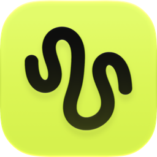
</p>

<h1 align="center">bowel</h1>

<p align="center">
bowel 是 macOS 上的 <a href="https://github.com/MetaCubeX/mihomo">mihomo</a> 客户端。
</p>

<p align="center">
  <a href="https://github.com/21stware/bowel/releases/latest"><b>下载 macOS 版</b></a> ·
  <a href="https://21stware.github.io/bowel/">官网</a> ·
  <a href="README.md">English</a>
</p>

<p align="center">
  <picture>
    <source media="(prefers-color-scheme: dark)" srcset="site/shots/home-zh-dark.webp">
    
  </picture>
</p>

界面使用 Go 开发并通过 GPU 渲染，不使用 WebView。

## 界面与功能

### 路由
按用途分配不同路由，可手动指定出口节点或由自动测速选择。

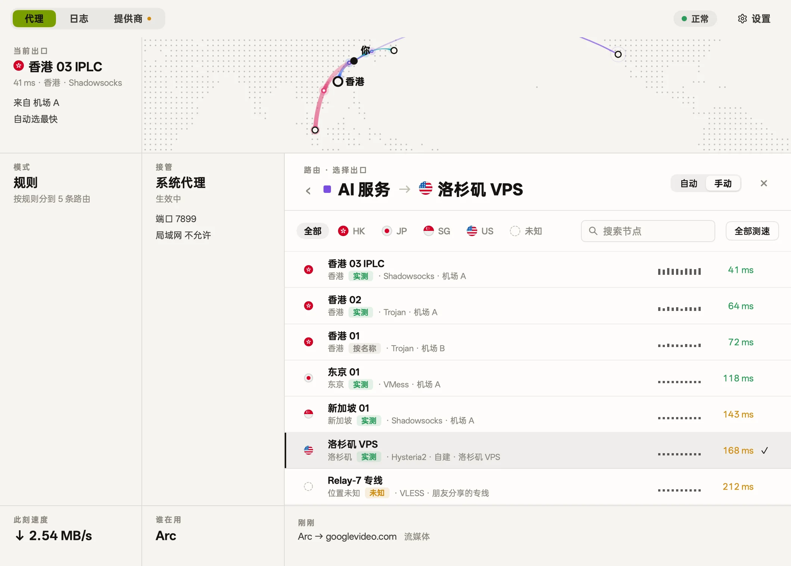

### 连接
查看每个连接的应用、目标、规则、出口和速率，也可以直接修改指定域名的路由。

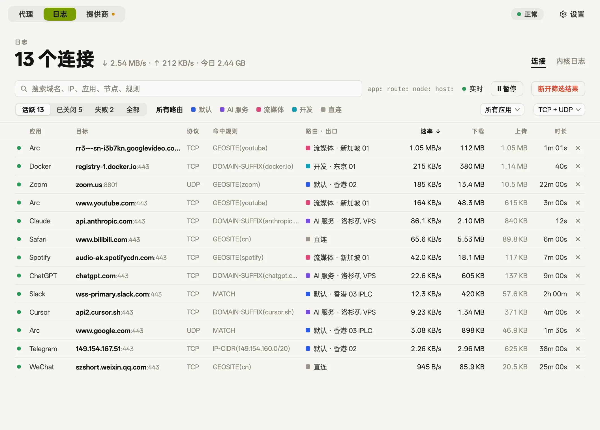

### 提供商
支持添加订阅链接、节点链接、YAML 配置或扫码导入，并显示流量与到期时间。

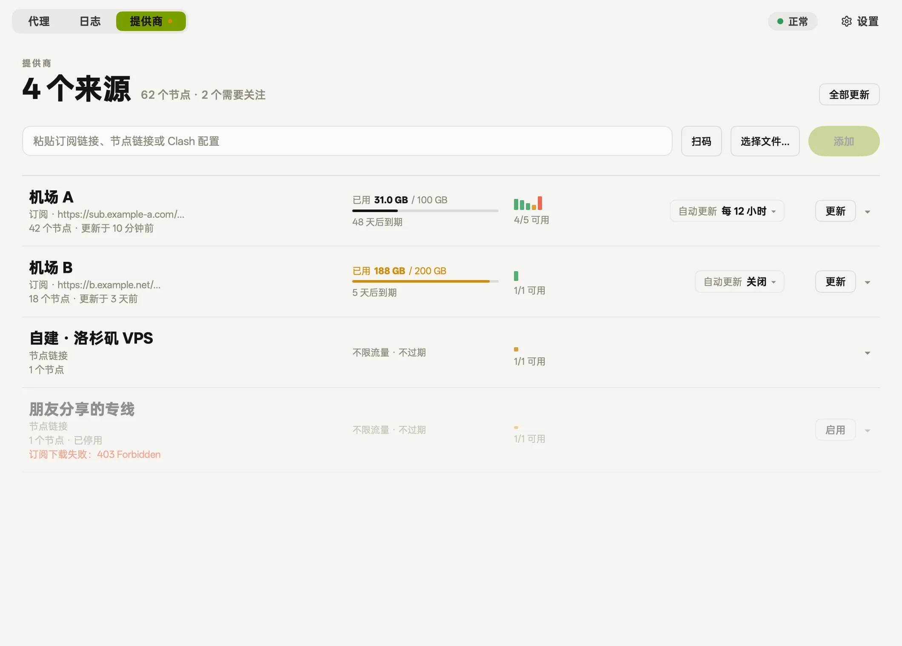

### 菜单栏
支持在菜单栏开关接管状态、切换运行模式和默认出口节点。

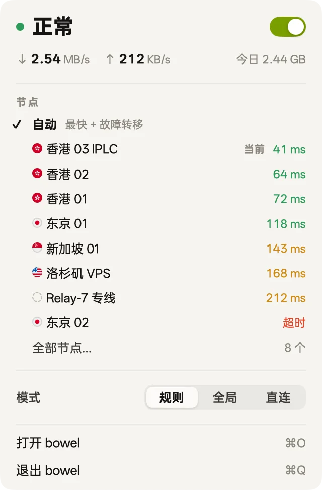

### 主题皮肤
六种皮肤，换的是整个界面的样子。

<table>
  <tr>
    <td>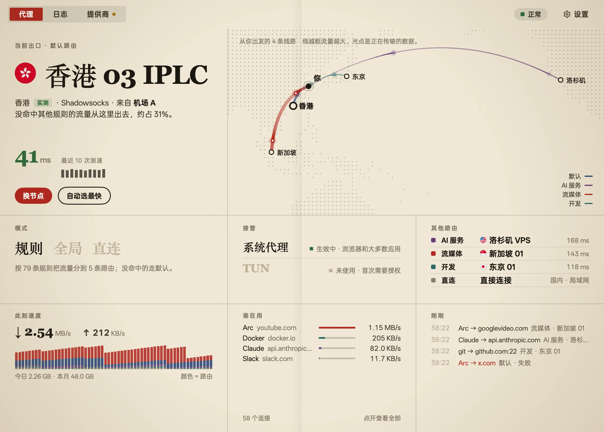<br><sub>报刊</sub></td>
    <td>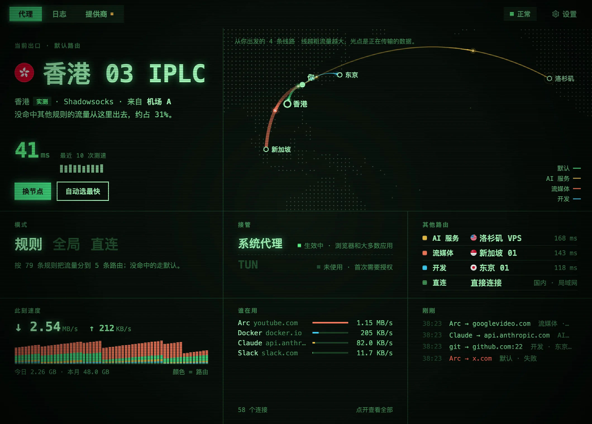<br><sub>荧光屏</sub></td>
    <td>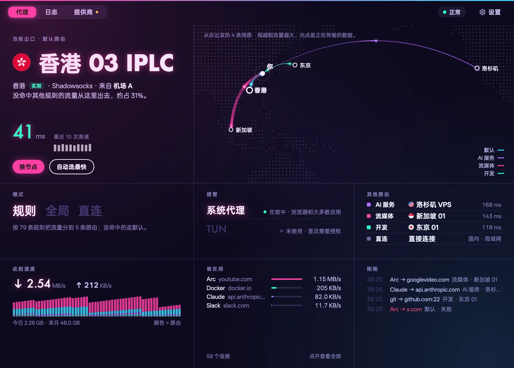<br><sub>霓虹</sub></td>
  </tr>
  <tr>
    <td>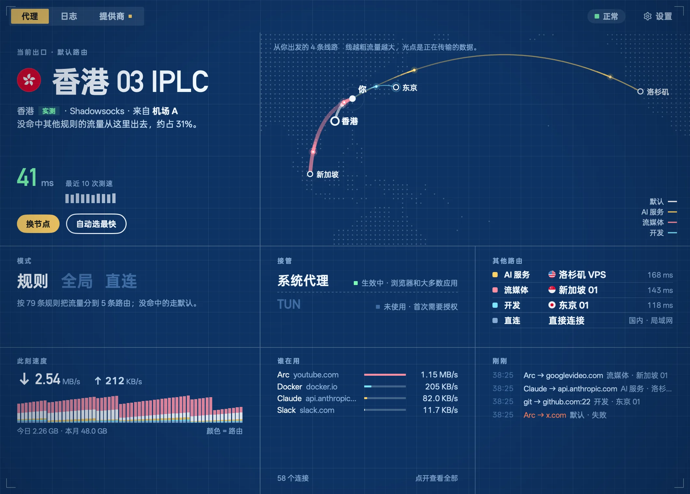<br><sub>蓝图</sub></td>
    <td>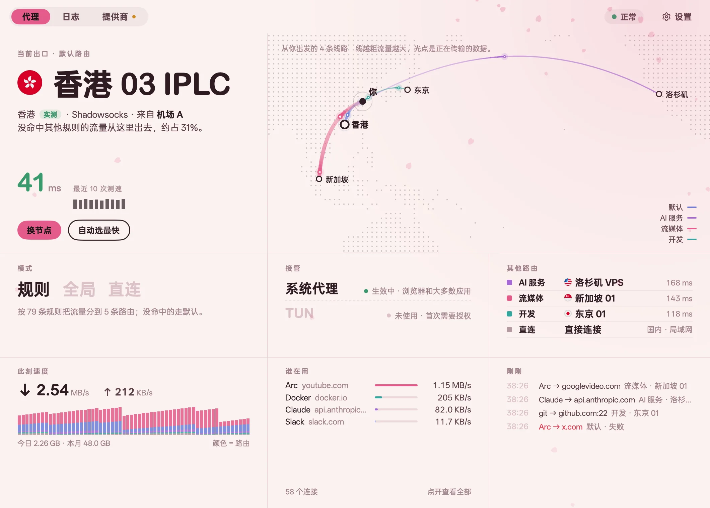<br><sub>樱</sub></td>
    <td>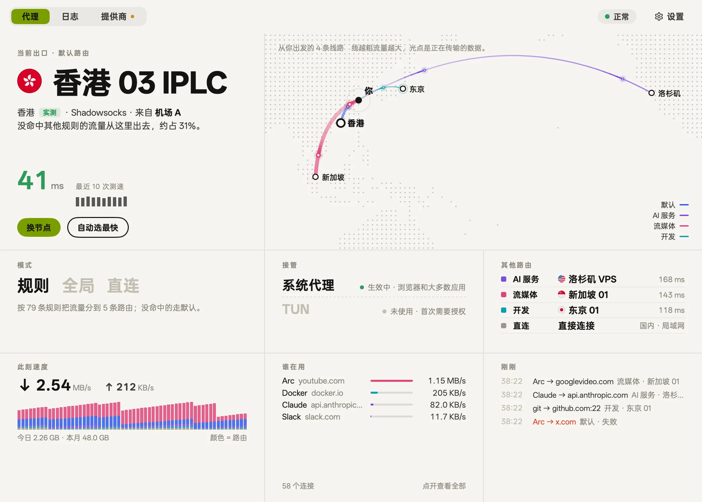<br><sub>纸墨（默认）</sub></td>
  </tr>
</table>

### 其他
- **自定义规则**：支持按域名、关键词或 IP 段添加分流规则并测试匹配结果。
- **出口位置实测**：通过 Cloudflare 请求实测节点真实的出口所在地。
- **网关模式**：支持作为局域网网关为电视、游戏机和手机提供代理服务。
- **TUN**：接管不遵循系统代理设置的应用程序流量。
- **MCP**：内置 MCP 服务器，供 Claude Code 等 Agent 读取状态、排查网络问题，改设置前默认先问你。
  ```bash
  claude mcp add --scope user bowel -- /Applications/bowel.app/Contents/MacOS/bowel mcp
  ```
- **设置与语言**：设置项支持搜索（⌘F），支持简体中文、繁體中文、English 与日本語，支持浅色与深色。

## 安装

1. 从 [Releases](https://github.com/21stware/bowel/releases/latest) 下载 `bowel-<版本>-arm64.dmg`，把 bowel 拖进「应用程序」。
2. 打开后添加一个 Provider（订阅链接、节点链接或扫码），打开接管。

需要 macOS 12 或更新版本，目前发布的是 Apple 芯片版本。安装包用 Developer ID 签名，并经过 Apple 公证。

## 开发

需要 Go 1.27.3+（`GOTOOLCHAIN=auto` 会自动下载）。不需要 Node 或 Bun。

```bash
./scripts/fetch-core.sh     # 下载 mihomo 内核和 GeoSite/GeoIP 数据到 resources/
go tool mygo dev            # 运行，改代码自动重建
go tool mygo build          # 打包 bowel.app 和 .dmg（已签名，未公证）
./scripts/release.sh        # 打包、公证并装订，发版用这个
CGO_ENABLED=0 go test ./... # 包含会启动真实内核的测试
./scripts/site-shots.sh     # 重新生成 README 和官网的截图（需要 cwebp）
```

- 工作原理与代码结构：[docs/architecture.md](docs/architecture.md)
- 产品信息架构：[docs/product-ia.md](docs/product-ia.md)
- 官网是 `site/` 下的静态页面，直接打开 `site/index.html` 即可预览。合入 `main` 后自动上线。
- 发版时先改 `mygo.json` 里的版本号，再推送对应的标签（如 `v0.1.0`）。GitHub Actions 会打包、签名、公证，并把磁盘映像附到新的 Release 上。

bowel 原名 Moho。Go 模块仍是 `github.com/oboo/moho`，Bundle ID 仍是 `dev.moho.app`（保留 macOS 已授予的摄像头和录屏权限）。首次启动时，`~/Library/Application Support/Moho` 里的数据会迁移到 `…/bowel`。

## 致谢

- [mihomo](https://github.com/MetaCubeX/mihomo)：代理内核，GPL-3.0。bowel 把它作为独立进程运行，不链接它的代码。
- [MyGo](https://github.com/egoist/mygo)：原生 Go UI 框架。
- [OPPO Sans](resources/fonts/)：界面字体。

## 许可证

bowel 采用 [PolyForm Noncommercial License 1.0.0](LICENSE) 授权，仅限非商业用途。如需商业授权，请[提交 issue](https://github.com/21stware/bowel/issues)。

随应用打包的 mihomo 内核仍适用 GPL-3.0。`assets/flags/` 中的旗帜图片和 `resources/fonts/` 中的字体属于第三方文件，仍适用各自的许可证。
