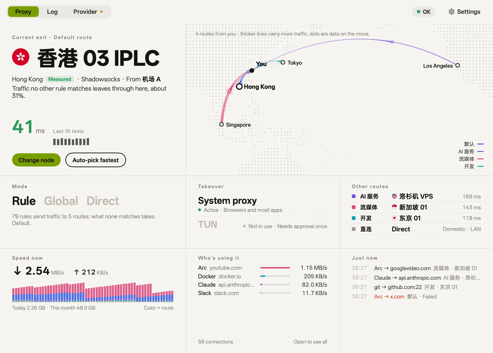

# Install and get started

## Install

macOS, with [Homebrew](https://brew.sh):

```bash
brew install --cask 21stware/tap/bowel
```

Windows, in PowerShell:

```powershell
irm https://github.com/21stware/bowel/releases/latest/download/install.ps1 | iex
```

Debian, Ubuntu and Fedora. This adds a signed package repository, so `apt` or `dnf` updates bowel from then on:

```bash
curl -fsSL https://21stware.github.io/packages/install.sh | sh
```

Or download the file for your platform from [Releases](https://github.com/21stware/bowel/releases/latest):

| Platform | File | Needs |
| --- | --- | --- |
| macOS | `bowel-<version>-arm64.dmg` | macOS 12 or later, Apple silicon |
| Windows | `bowel-setup-<version>-amd64.exe` or `-arm64.exe` | x64 or Arm64 |
| Linux | `bowel_<version>_<arch>.deb`, `bowel-<version>-1.<rpm arch>.rpm` or `bowel-<version>-linux-<arch>.tar.gz` | amd64 or arm64 |
| Android | `bowel-<version>-android-arm64.apk`, or `-armv7.apk` for 32-bit TV boxes | Android 8.0 or later, arm64 or armv7 |

- **macOS**: Drag bowel into Applications. The app is signed with a Developer ID and notarized by Apple.
- **Windows**: Run the installer. It isn't code-signed, so Windows may warn you before it runs.
- **Linux**: Install the `.deb` or `.rpm`. For a user install in `~/.local`, download `install.sh` and the `.tar.gz` from the same release, then run `sh install.sh bowel-<version>-linux-<arch>.tar.gz` without unpacking the archive. This is separate from the package-repository script above.
- **Android**: Install the APK, allowing your browser to install apps if asked. Android asks for VPN permission the first time you connect.
- **iOS**: Not released yet.

## First steps

1. **Add a provider.** Under Providers, click Add provider and give it a subscription URL, node links such as `vless://` or `hy2://`, a Clash or mihomo YAML file, or a QR code. Each source shows its data usage and expiry. When it is a complete config with route groups and rules of its own, bowel asks whether to route by them or only use its nodes.
2. **Turn on takeover.** On the home page, or from the menu bar (the system tray on Windows and Linux). By default this sets the system proxy; for programs that ignore it, use TUN. Both are on [Takeover, TUN and the exit lock](takeover.md). On Android, takeover is the system VPN.
3. **Pick a node for each purpose.** AI services, streaming, development and the rest are separate route groups, each with its own node, chosen by hand or by speed: [Route groups and nodes](routes.md).



Only one client should take over the system proxy or TUN at a time. Coming from another Clash client, quit it first: [Questions](faq.md#coming-from-another-clash-client).

## What each platform has

| | macOS | Windows | Linux | Android |
| --- | --- | --- | --- | --- |
| Takeover | System proxy or TUN | System proxy or TUN | System proxy (GNOME, KDE) or TUN | System VPN |
| Gateway mode | Yes | No | Yes | No |
| Developer tools | Yes | No | Yes (zsh, bash) | No |
| Scan QR codes on the screen | Yes | Yes | Yes | No |
| Scan QR codes with the camera | Yes | No | No | Yes |
| MCP server | Yes | Yes | Yes | No |
| Command line and `bowel daemon` | Yes | Yes | Yes | No |
| Route by app (rules) | Yes | Yes, never run on a real machine by us | Yes | Android 10 or later |
| Apps that skip bowel (exclusion list) | None | None | None | Yes, applies after a reconnect |
| Download test | Yes | Yes | Yes | No |

What each system does underneath, and how far each has been tried, is in [platform parity](../platform-parity.md).

## Next

The command line: `bowel status`, `bowel on`, `bowel route use ai auto` and the rest are in the [README](../../README.md#command-line); the full-screen `bowel tui`, `bowel bar` and `bowel daemon` are in [Command line](../cli.md).

Agents: bowel has an MCP server that Claude Code and other agents use to read its state and troubleshoot connections. It asks you before they change anything. On macOS:

```bash
claude mcp add --scope user bowel -- /Applications/bowel.app/Contents/MacOS/bowel mcp
```

On Windows and Linux, use the path of the bowel program.
