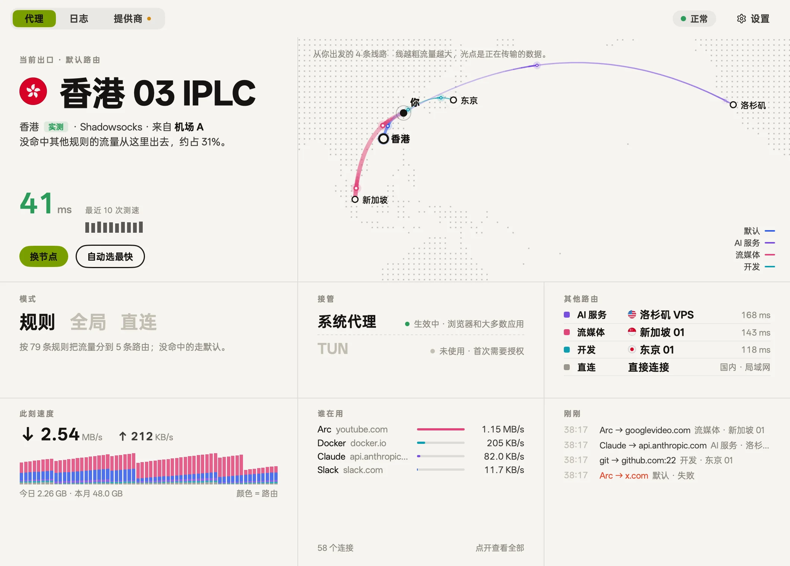

# 安装与开始使用

## 安装

macOS，使用 [Homebrew](https://brew.sh)：

```bash
brew install --cask 21stware/tap/bowel
```

Windows，在 PowerShell 中运行：

```powershell
irm https://github.com/21stware/bowel/releases/latest/download/install.ps1 | iex
```

Debian、Ubuntu 和 Fedora。这条命令会添加一个已签名的软件源，之后由 `apt` 或 `dnf` 更新 bowel：

```bash
curl -fsSL https://21stware.github.io/packages/install.sh | sh
```

也可以从 [Releases](https://github.com/21stware/bowel/releases/latest) 下载对应平台的安装包：

| 平台 | 文件 | 要求 |
| --- | --- | --- |
| macOS | `bowel-<版本>-arm64.dmg` | macOS 12 或更新版本，Apple 芯片 |
| Windows | `bowel-setup-<版本>-amd64.exe` 或 `-arm64.exe` | x64 或 Arm64 |
| Linux | `bowel_<版本>_<架构>.deb`、`bowel-<版本>-1.<rpm 架构>.rpm` 或 `bowel-<版本>-linux-<架构>.tar.gz` | amd64 或 arm64 |
| Android | `bowel-<版本>-android-arm64.apk` | Android 8.0 或更新版本，arm64 |

- **macOS**：把 bowel 拖进「应用程序」。安装包用 Developer ID 签名，并经过 Apple 公证。
- **Windows**：运行安装程序。安装包没有代码签名，运行前 Windows 可能会弹出提示。
- **Linux**：安装 `.deb` 或 `.rpm`。要安装到当前用户的 `~/.local`，从同一个 Release 下载 `install.sh` 和 `.tar.gz`，不用解压，运行 `sh install.sh bowel-<版本>-linux-<架构>.tar.gz`。这个脚本与上面添加软件源的脚本不同。
- **Android**：安装 APK，如有提示请允许浏览器安装应用。首次连接时系统会请求 VPN 权限。
- **iOS**：暂未发布。

## 开始使用

1. **添加提供商。** 在「提供商」里点「添加提供商」，填入订阅链接、`vless://`、`hy2://` 这样的节点链接、Clash 或 mihomo 的 YAML 配置文件，或者扫二维码。每个来源都会显示用量和到期时间。如果它是一份自带路由组和规则的完整配置，bowel 会问你是按它的路由分流，还是只用它的节点。
2. **打开接管。** 在首页，或者在菜单栏（Windows 和 Linux 上是系统托盘）里打开。默认是设置系统代理；不读系统代理的程序要用 TUN。两者见[接管、TUN 与出口锁定](takeover.zh-CN.md)。Android 上的接管就是系统 VPN。
3. **按用途选节点。** AI 服务、流媒体、开发和其他流量是各自独立的路由组，各用各的节点，可以手动选，也可以按速度自动选：见[路由组与节点](routes.zh-CN.md)。



同一时间只应有一个客户端接管系统代理或 TUN。从别的 Clash 客户端换过来的话，先退出原来那个：见[常见问题](faq.zh-CN.md#从别的-clash-客户端换过来)。

## 各平台有哪些功能

| | macOS | Windows | Linux | Android |
| --- | --- | --- | --- | --- |
| 接管方式 | 系统代理或 TUN | 系统代理或 TUN | 系统代理（GNOME、KDE）或 TUN | 系统 VPN |
| 网关模式 | 支持 | 不支持 | 支持 | 不支持 |
| 开发工具 | 支持 | 不支持 | 支持（zsh、bash） | 不支持 |
| 扫描屏幕上的二维码 | 支持 | 支持 | 支持 | 不支持 |
| 用摄像头扫描二维码 | 支持 | 不支持 | 不支持 | 支持 |
| MCP 服务器 | 支持 | 支持 | 支持 | 不支持 |
| 命令行和 `bowel daemon` | 支持 | 支持 | 支持 | 不支持 |
| 按 App 分流（规则） | 支持 | 支持，我们未在真机上运行过 | 支持 | Android 10 及以上 |
| 不走 bowel 的 App（排除列表） | 没有 | 没有 | 没有 | 支持，重新连接后生效 |
| 测下载 | 支持 | 支持 | 支持 | 不支持 |

各系统底下具体怎么做、各自试到了什么程度，见 [platform parity](../platform-parity.md)（英文）。

## 接下来

命令行：`bowel status`、`bowel on`、`bowel route use ai auto` 等常用命令见 [README](../../README.zh-CN.md#命令行)；全屏的 `bowel tui`、`bowel bar` 和 `bowel daemon` 见[命令行](../cli.zh-CN.md)。

Agent：bowel 自带 MCP 服务，Claude Code 等 Agent 可以用它读取状态、排查连接，修改设置前会先问你。macOS 上：

```bash
claude mcp add --scope user bowel -- /Applications/bowel.app/Contents/MacOS/bowel mcp
```

Windows 和 Linux 上请换成 bowel 程序所在的路径。
