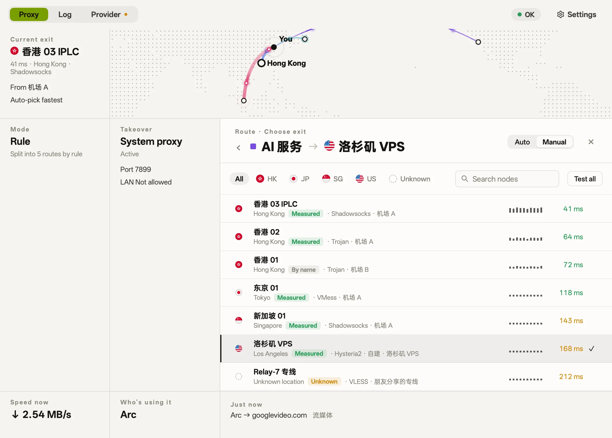
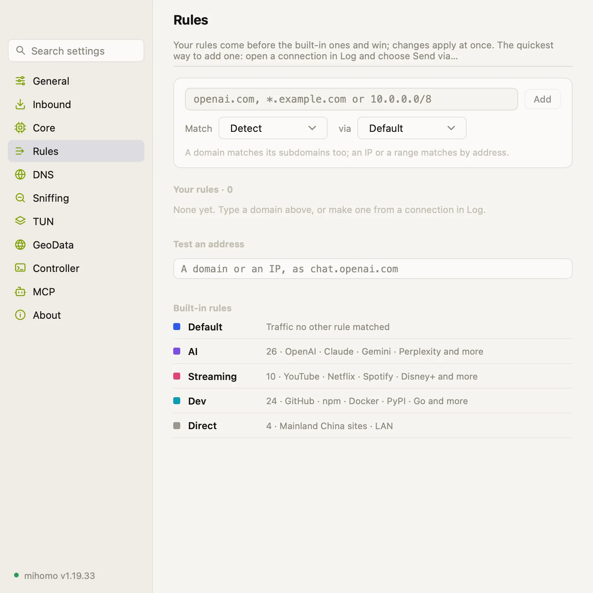

# Route groups and nodes

bowel sorts traffic by purpose into route groups, and each group has its own node: AI services can go out through one exit and streaming through another, while sites in mainland China go direct.



## The built-in groups

| Group | What it holds |
| --- | --- |
| AI | OpenAI, Claude, Gemini, Perplexity and more |
| Streaming | YouTube, Netflix, Spotify, Disney+ and more |
| Dev | GitHub, npm, Docker, PyPI, Go and more |
| Direct | Mainland China sites and the LAN, never through a node |
| Block | Connections matching its rules are refused |
| Other | Traffic no rule matched |

Groups are matched in order, top to bottom, and only Other stays last. Drag a group's handle in the route group list to move it (on Android, the up and down arrows; [without the window](#without-the-window), `bowel route move`): with Block at the top, for instance, its rules win over equally specific rules in other groups. You can add groups of your own.

Addresses on the LAN, Tailscale and company VPNs go direct whatever the groups say, in global mode too; [developer networks](../dev-network.md) says which and why.

## Choosing a node

Click a group on the home page and choose its exit. Its node strategy is one of:

- **Fixed node**: the node you picked, and no other. If it stops working, the group can't connect until you pick another.
- **Fastest**: bowel tests the nodes and uses the one with the lowest delay on the group's main test site. You can narrow the nodes it chooses from by region, by source, and by picking nodes by hand; the scope is the nodes that meet all three.
- **Fallback**: the nodes in the order you set, the first that works.

Test all, in the node list, measures every node again.

## Test sites

Delay depends on where it is measured, so each group has test sites of its own. Open Test sites in the group's node list:

- The first is the **main** target: the node list's delays and Fastest go by it. To change it, click Make main beside another site.
- The others are only tested through the current node, for reference.
- Add a site by its address, or Reset to the defaults.

### Why a node shows Denied

The APIs of OpenAI and Anthropic answer 403 to exits they don't serve, before they ask for a key. So the AI group's default test sites are `api.openai.com/v1/models` and `api.anthropic.com/v1/models` (no key is needed, and nothing about your account is sent), and a node that gets 403 there shows **Denied** instead of a delay. Fastest and Fallback leave it out; Timeout means nothing answered at all.

- Fastest goes by the main site alone, OpenAI by default. To choose by Claude, make Anthropic's site main.
- Gemini has no signal that tells without a key, so it is only tested for an answer.
- A 403 can also mean that one address is flagged, so bowel says Denied, not why.
- A group on a fixed node is only told, not switched.

## Download test

A low delay says a node answers a small request quickly, not that it downloads fast. Downloads, beside the search box in Choose exit, takes the five nodes with the lowest delay on the group's main site among those the node list shows (Fastest's scope, or the region picked above it for Fixed node and Fallback, and only what the search finds when there is one), and the node in use, and downloads a test file through each, one after another: up to 5 seconds or 50 MB each. The rates show in a column of the node list.

- A dialog first lists the nodes and the most traffic it may use. Mind it on a metered subscription; some providers don't allow speed tests.
- Nothing is switched to: you choose.
- Fastest can also choose by download speed: set By to Download speed, and every 6, 12 or 24 hours a round tests the five nodes in scope with the lowest delay (and the one in use), 20 MB at most each, and moves to the fastest download; the node in use stays if it came within a fifth of it. Downloads then reads Test round now: it runs the round at once and switches by its result, and the next round is counted from then. Rounds run with takeover off too, since apps pointed at bowel's port go by the groups all the same.
- When three or more nodes come out within a fifth of each other, your own line is likely the limit.
- The test file is Cloudflare's by default; change it under Settings › Testing › Download test file.
- The test you start yourself is desktop only for now: the phone and the command line have none. Choosing by download speed can be set from the command line too: `bowel route strategy <group> --by download --every 12`.

## Without the window

A bowel with no window, under `bowel daemon` or in Docker, is set up the same way from the command line, the full-screen `bowel tui` or an agent: groups are made, ordered and named, and given a strategy, a range, a way of choosing and test sites.

```bash
bowel route new Work --at 1                       # a group of your own, tried first
bowel rules add corp.example Work                 # what it takes
bowel route order Work "🇯🇵 Tokyo 02" "🇸🇬 Singapore 01"   # Fallback, first preferred
bowel route scope Work --regions JP,SG            # Fastest's range, for when it's on Fastest
bowel route sites Work https://intranet.corp.example   # its main test site
bowel route show Work                             # all of it
```

Every command is in [the command line page](../cli.md#route-groups). While a Provider's own config routes the traffic, its groups are used and these commands refuse; `bowel routing bowel` goes back to bowel's own.

## Rules

A rule sends matching connections to a route group: a domain, a keyword, an IP range, or an app. In Settings › Rules you can also test where an address goes.



From the command line:

```bash
bowel rules add openai.com ai     # send openai.com to the AI group
bowel rules test api.openai.com   # which rule and group an address meets
```

In the Connections log, each connection shows its app, destination, rule, exit and speed, and can be sent to another group from there.

### Routing by app

An App rule hands all of one app's connections to a group, and pinning that group to a fixed node sends the app through one node. It works on macOS, Windows, Linux and Android 10 or later. On macOS, a rule for Safari misses its pages: they are loaded by the system's WebKit network process, and bowel offers to use that process instead.

On Android, Settings › Apps that skip bowel is something else: an app on that list stays outside the VPN and connects directly, where no rule reaches it. bowel has no mode that proxies only the apps you select.
