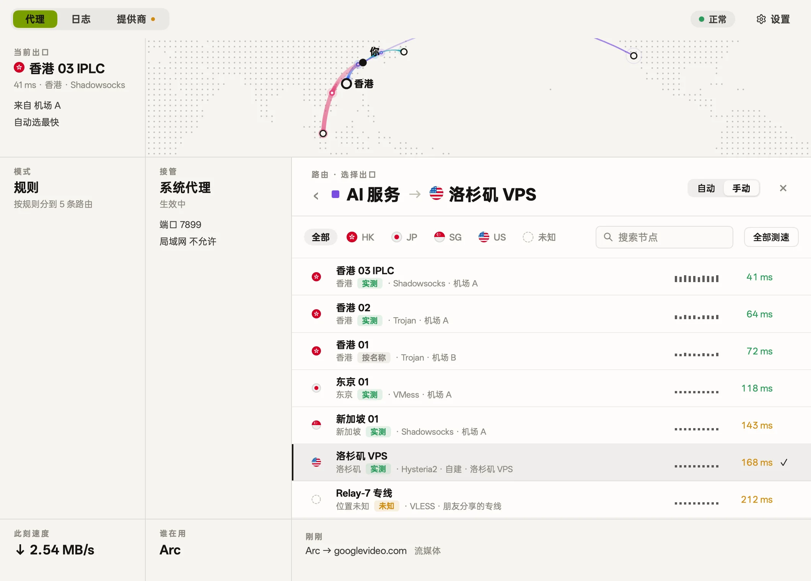
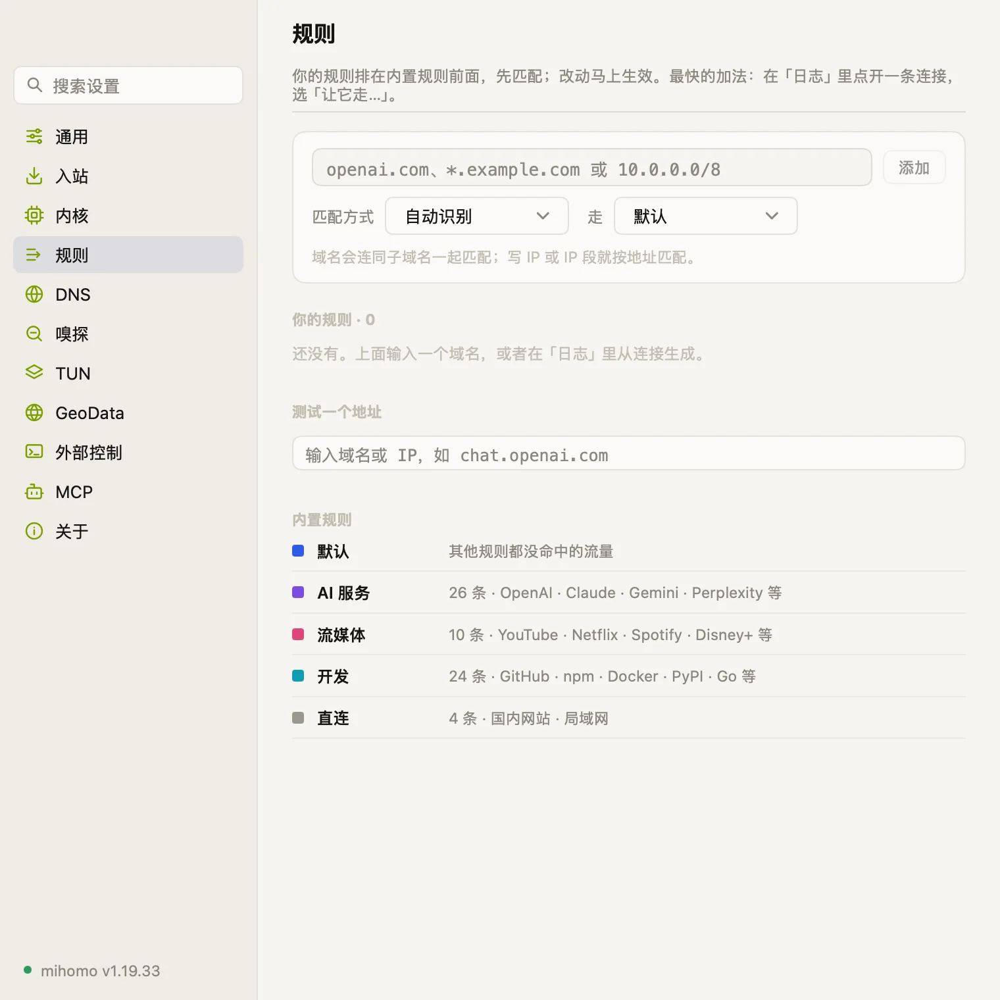

# 路由组与节点

bowel 按用途把流量分进不同的路由组，每个路由组用自己的节点：AI 服务可以从一个出口出去，流媒体从另一个，国内网站则直接连接。



## 内置的路由组

| 路由组 | 管哪些流量 |
| --- | --- |
| AI 服务 | OpenAI、Claude、Gemini、Perplexity 等 |
| 流媒体 | YouTube、Netflix、Spotify、Disney+ 等 |
| 开发 | GitHub、npm、Docker、PyPI、Go 等 |
| 直连 | 国内网站和局域网，从不走节点 |
| 拦截 | 命中规则的连接会被拒绝 |
| 其他流量 | 没命中任何规则的流量 |

路由组从上到下依次匹配，只有「其他流量」固定在最后。在路由组列表里拖动一行的手柄就能调整顺序（Android 上用上移、下移箭头；[不开窗口时](#不开窗口时)用 `bowel route move`）：比如把「拦截」拖到最上面，同样具体的规则里拦截的先生效。也可以新建自己的路由组。

局域网、Tailscale 和公司 VPN 的地址不管路由组怎么设都直接连接，全局模式下也一样；具体是哪些、为什么，见 [developer networks](../dev-network.md)（英文）。

## 选节点

在首页点开一个路由组「选择出口」。节点策略有三种：

- **固定节点**：只用你选的那个节点。它不能用了，这个路由组就连不上，直到你换一个。
- **自动最快**：bowel 测速，用在这个路由组的主测速站点上延迟最低的节点。可以按地区、按来源、或者手动挑节点来缩小范围，范围是三者同时满足的节点。
- **顺序备用**：按你排好的顺序，用第一个能用的节点。

节点列表里的「全部测速」把所有节点重新测一遍。

## 测速站点

延迟取决于在哪儿测，所以每个路由组有自己的测速站点。在路由组的节点列表里打开「测速站点」：

- 第一个是**主目标**：节点列表的延迟和自动选择都按它。要换的话，在另一个站点旁边点「设为主目标」。
- 其余的只经当前节点测，用来参考。
- 可以输入网址添加站点，或者「恢复默认」。

### 节点为什么显示「被拒绝」

OpenAI 和 Anthropic 的 API 对不提供服务的出口直接回 403，不等你给 key。所以「AI 服务」默认的测速站点是 `api.openai.com/v1/models` 和 `api.anthropic.com/v1/models`（不需要 key，请求里不带任何账号信息），节点在这里得到 403 时显示**被拒绝**，不记延迟。自动最快和顺序备用都不会选它；「超时」则是完全没有应答。

- 自动选择只看主站点，默认是 OpenAI。要按 Claude 来选，把 Anthropic 的站点设为主目标。
- Gemini 没有不带 key 就能分辨的信号，仍然只测通不通。
- 403 也可能是这个 IP 被风控，所以只写「被拒绝」，不说原因。
- 固定节点的路由组只提示，不替你换。

## 测下载

延迟低只说明节点回应小请求快，不说明它下载快。「选择出口」里搜索框旁边的「测下载」，从节点列表当前列出的节点里（自动最快按它的范围，固定节点和顺序备用按上面选的地区，搜索框里有字时只算搜到的）取主站点上延迟最低的 5 个，加上正在用的节点，依次下载一个测速文件，每个最多 5 秒、最多 50 MB，节点列表里会多出一列下载速度。

- 开始前会弹窗列出要测哪些节点、最多用掉多少流量。订阅按流量计费的话请留意；有的机场不允许测速。
- 测完不会自动换节点，由你自己选。
- 自动最快也可以按下载速度选：在「选法」里选「下载速度」，每 6、12 或 24 小时从范围里取延迟最低的 5 个节点（加上正在用的）测一轮，每个最多 20 MB，换到下载最快的；正在用的慢不到五分之一就不换。这时「测下载」变成「现在测一轮」：不等下一轮，现在就测并按结果换，下一轮从测完时算起。接管关着时也照常测，因为直接用本地端口的应用也走这些路由组。
- 三个以上节点测出来相差两成以内时，瓶颈可能在你本地的网络。
- 测速文件默认是 Cloudflare 的，可以在「设置 › 测速」的「下载测速文件」里换。
- 自己点的「测下载」目前只有桌面版有，手机版和命令行还没有。按下载速度选在命令行里也能设：`bowel route strategy <路由组> --by download --every 12`。

## 不开窗口时

没有窗口的 bowel（用 `bowel daemon` 运行，或在 Docker 里）照样能配：用命令行、全屏的 `bowel tui` 或 agent，新建、排序、改名路由组，设置节点策略、范围、选法和测速站点。

```bash
bowel route new Work --at 1                       # 新建自己的路由组，排在最前
bowel rules add corp.example Work                 # 它管哪些流量
bowel route order Work "🇯🇵 Tokyo 02" "🇸🇬 Singapore 01"   # 顺序备用，第一个优先
bowel route scope Work --regions JP,SG            # 自动最快的范围，切到自动最快时用
bowel route sites Work https://intranet.corp.example   # 它的主测速站点
bowel route show Work                             # 查看全部设置
```

全部命令见[命令行](../cli.zh-CN.md#路由组)。正在使用某个 Provider 配置自带的路由时，用的是那份配置的路由组，这些命令会拒绝；`bowel routing bowel` 改回 bowel 自己的。

## 规则

规则把匹配的连接交给某个路由组：按域名、关键词、IP 段或 App。在「设置 › 规则」里还可以测一个地址会走哪里。



命令行：

```bash
bowel rules add openai.com ai     # 让 openai.com 走「AI 服务」
bowel rules test api.openai.com   # 这个地址命中哪条规则、走哪个路由组
```

「连接」日志里每条连接都写着 App、目标、命中的规则、出口和速度，也可以在那里直接让它改走别的路由组。

### 按 App 分流

「应用」规则把一个 App 的所有连接交给一个路由组；把这个路由组设成固定节点，这个 App 就只走一个节点。macOS、Windows、Linux 和 Android 10 及以上都支持。macOS 上给 Safari 加的规则管不到网页：网页是系统的 WebKit 网络进程连的，bowel 会提示并可以一点改用那个进程。

Android 上「设置 ›「不走 bowel 的 App」」是另一回事：列表里的 App 完全不经过 VPN，直接联网，规则也管不到它。bowel 没有「只代理选中的 App」的模式。
